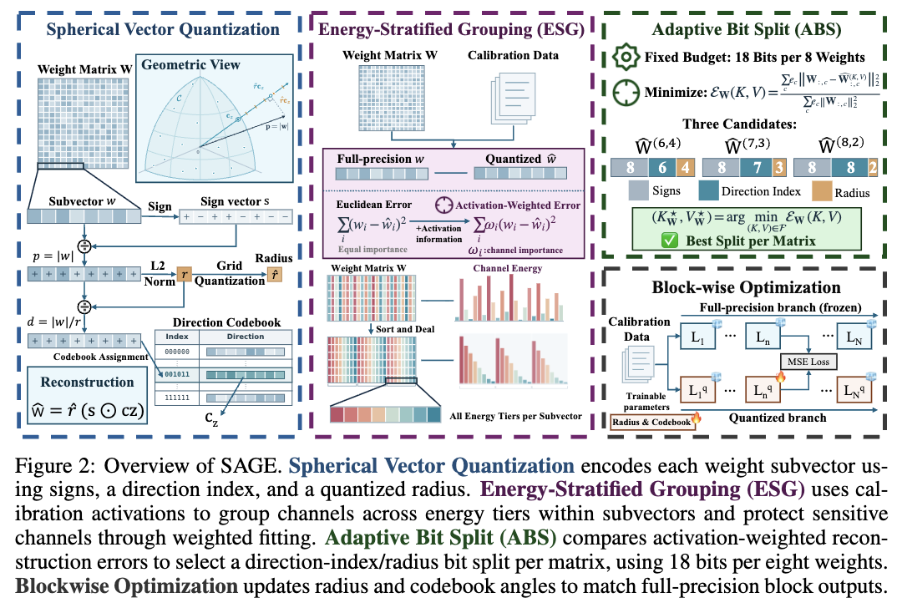
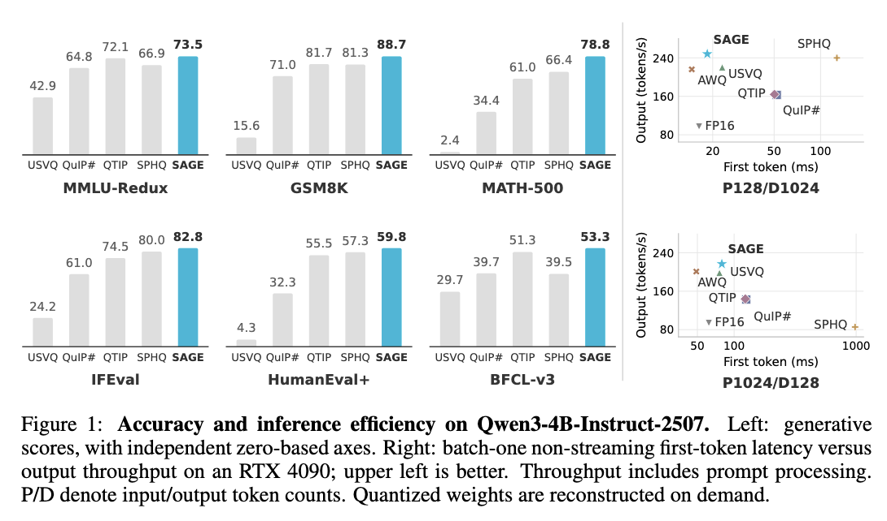
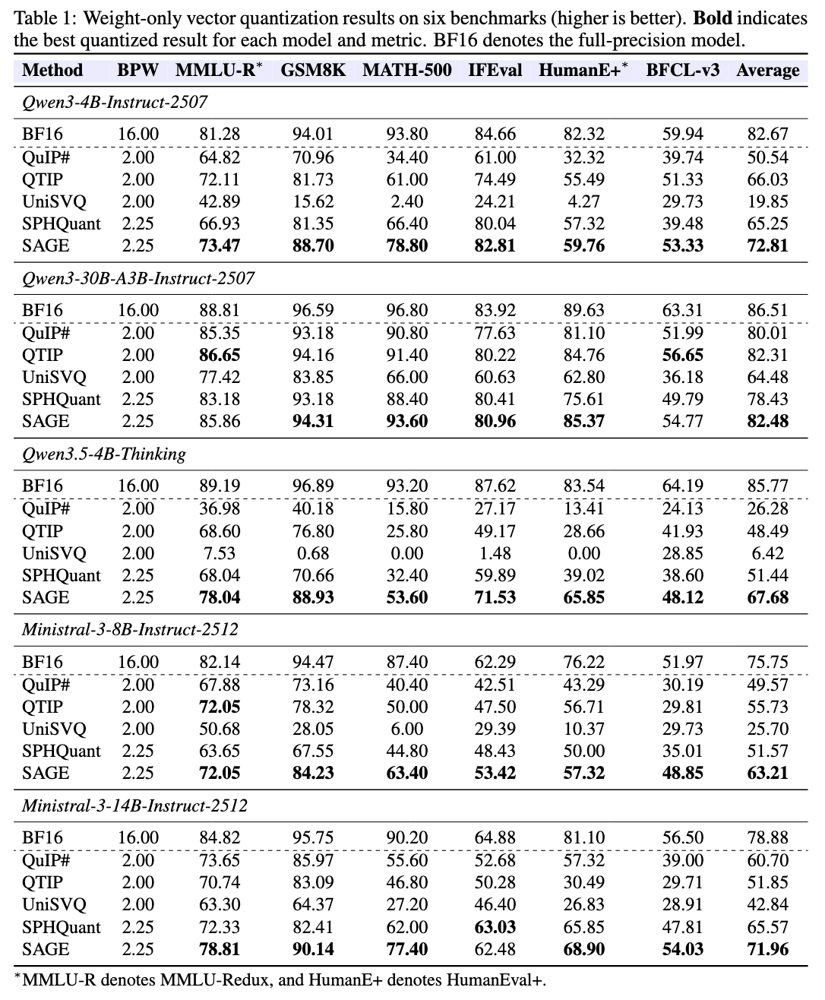
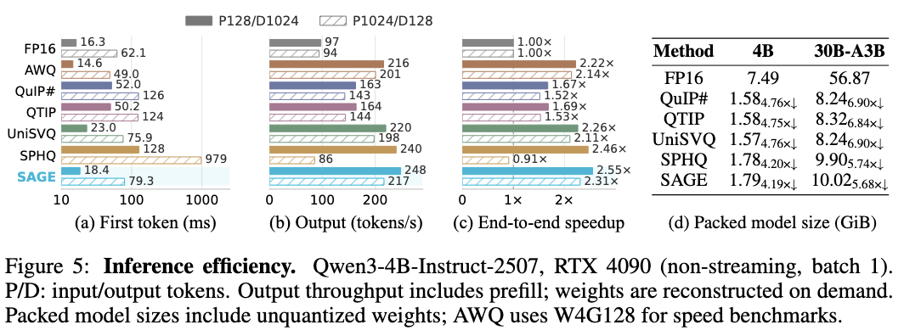

<h1 align="center">SAGE: Pushing 2-Bit Vector-Quantized LLMs toward Real-World Usability</h1>

<p align="center">
  <a href="https://arxiv.org/abs/2610.14745"></a>
  <a href="https://arxiv.org/pdf/2610.14745"></a>
  <a href="https://github.com/Zincwolf/sage"></a>
  <a href="https://huggingface.co/datasets/chizhongw/opd-data"></a>
</p>

<p align="center">
  <a href="https://xianglongyan.github.io/">Xianglong Yan</a><sup>*</sup>, Zenan Wu<sup>*</sup>, Kewei Zhang, Kaicheng Yang, and <a href="http://yulunzhang.com/">Yulun Zhang</a><sup>†</sup><br>
  Shanghai Jiao Tong University<br>
  <sup>*</sup>Equal contribution. <sup>†</sup>Corresponding author.
</p>

<p align="center"><strong>2.25 BPW</strong> encoding payload &nbsp;·&nbsp; <strong>95.3%</strong> of BF16 average score on Qwen3-30B-A3B &nbsp;·&nbsp; up to <strong>2.55×</strong> end-to-end speedup on Qwen3-4B</p>

SAGE is a weight-only vector quantization method designed to preserve the practical capabilities of large language models at an extremely low bit budget. This repository contains its quantization pipeline and CUDA inference kernels, alongside implementations of the comparison methods used in the paper.

## ✨ Overview

SAGE combines **Energy-Stratified Grouping (ESG)**, which groups channels from different activation-energy tiers and prioritizes sensitive channels during fitting, with **Adaptive Bit Split (ABS)**, which chooses the direction-codebook and radius bit allocation separately for each weight matrix. Its encoding payload is **2.25 bits per weight**, excluding shared metadata.



## 📊 Results

SAGE is evaluated on five models and six generative benchmarks covering knowledge, mathematics, code generation, instruction following, and tool use. The figure below summarizes accuracy and batch-one inference efficiency for **Qwen3-4B-Instruct-2507**. The plots on the left use independent zero-based axes; the speed measurements on the right use an RTX 4090 with on-demand weight reconstruction.



<details>
<summary><strong>Full accuracy results across five models</strong></summary>



</details>

### Inference efficiency

The following measurements use **Qwen3-4B-Instruct-2507**, batch-one non-streaming generation, an **RTX 4090**, FP16 activations and KV cache, and packed weights reconstructed on demand. SAGE reaches **2.31–2.55×** end-to-end speedup over dense FP16 across the two shown input/output lengths. Packed model sizes include unquantized parameters.



## ⚙️ Installation

The quantization and CUDA build require **Linux**, an **NVIDIA GPU**, **CUDA 12.8**, **Python 3.11**, and [uv](https://docs.astral.sh/uv/). Clone the repository, initialize the pinned submodules, apply their patches, and install the locked environment:

```bash
git clone https://github.com/Zincwolf/sage.git
cd sage
git submodule update --init
for patch_dir in patches/*; do
    (cd "third_party/${patch_dir##*/}" && git am "../../$patch_dir"/*.patch) || exit 1
done
CUDA_HOME=/usr/local/cuda-12.8 uv sync --locked
```

Set `CUDA_HOME` to your CUDA 12.8 installation path. The initial sync downloads dependencies and builds CUDA extensions. Applying patches with `git am` requires a configured Git committer identity; see [Third-party components](THIRD_PARTY.md#initial-checkout) for details.

## 🚀 Quick start: quantize with SAGE

Prepare a **local Hugging Face model** and a tokenized calibration artifact. The paper's [train data](https://huggingface.co/datasets/chizhongw/opd-data/blob/main/text/train_clean_balanced.parquet) and [validation data](https://huggingface.co/datasets/chizhongw/opd-data/blob/main/text/heldout_clean.parquet) can be downloaded together after installation:

```bash
uv run hf download chizhongw/opd-data \
    text/train_clean_balanced.parquet text/heldout_clean.parquet \
    --repo-type dataset --local-dir data
```

The files will be under `data/text/`. To construct the target-model self-rollout calibration artifact, see the [calibration configuration template](configs/data/opd.example.yaml) and `uv run wvq data --help`. Copy the [Qwen3 SAGE configuration](configs/sage/qwen3.example.yaml), set `model`, `calibration`, and `output_dir` to local paths, and run:

```bash
cp configs/sage/qwen3.example.yaml configs/sage/qwen3.yaml
# Edit the three paths in configs/sage/qwen3.yaml.
uv run wvq sage run --config configs/sage/qwen3.yaml
```

The command optimizes the model, exports it to `<output_dir>/exported_model/`, and validates the export. The default export contains standard Hugging Face **dense quantized-and-dequantized (QDQ) weights**. For a packed Qwen3 export using the CUDA inference path, set `export_compressed: true` **before running**; packed export is currently limited to the Qwen3 model family. Local configuration files are Git-ignored.

For a calibration artifact built from general text datasets instead of target-model self-rollouts, see the [calibration template](configs/data/calibration.example.yaml) and `uv run wvq data calibration --help`.

## 🔬 Reproducing the paper

- **Models:** Qwen3-4B-Instruct-2507, Qwen3-30B-A3B-Instruct-2507, Qwen3.5-4B-Thinking, Ministral-3-8B-Instruct-2512, and Ministral-3-14B-Instruct-2512. Corresponding SAGE templates are in [`configs/sage/`](configs/sage/).
- **Calibration and optimization:** The paper uses 1,920 training and 128 validation sequences of 2,048 tokens, with target-model self-rollouts. The default SAGE configuration enables ESG and ABS, uses energy exponent 0.75, and optimizes for 20 epochs. See the [calibration template](configs/data/opd.example.yaml) and [SAGE templates](configs/sage/) for the full settings.
- **Accuracy:** The six benchmarks are MMLU-Redux, GSM8K, MATH-500, IFEval, HumanEval+, and BFCL-v3. The paper evaluates the exported models with [EvalScope 1.10.0](https://github.com/modelscope/evalscope); this repository handles quantization and export rather than packaging the full accuracy-evaluation pipeline.
- **Inference:** For packed Qwen3 models, use the [benchmark configuration](configs/benchmarks/model.example.yaml) and `uv run wvq benchmark model --config <your-config.yaml>`. Match the paper's model, hardware, sequence lengths, and benchmark settings before comparing numbers.

Example configurations for QTIP, QuIP#, UniSVQ, and SPHQuant are also available in [`configs/`](configs/). Use `uv run wvq --help` for all commands.

## 🛠️ Development

```bash
uv run pytest
uv run ruff check .
uv run ruff format --check .
uv run basedpyright
```

## 📖 Citation

If you find SAGE useful, please cite our paper:

```bibtex
@misc{yan2026sage,
  title={SAGE: Pushing 2-Bit Vector-Quantized LLMs toward Real-World Usability},
  author={Yan, Xianglong and Wu, Zenan and Zhang, Kewei and Yang, Kaicheng and Zhang, Yulun},
  year={2026},
  eprint={2610.14745},
  archivePrefix={arXiv},
  primaryClass={cs.AI},
  url={https://arxiv.org/abs/2610.14745}
}
```

## ⚖️ License and acknowledgements

Project-owned code is licensed under [GPL-3.0-only](LICENSE). The repository builds on QTIP, QuIP#, UniSVQ, ParoQuant/SPHQuant, and Fast Hadamard Transform. Their pinned versions, licenses, and local patches are documented in [THIRD_PARTY.md](THIRD_PARTY.md). Model checkpoints and datasets retain their respective terms.
